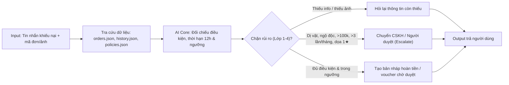

# AI SPEC — [Tên lát cắt] · Nhóm [tên nhóm] · Phòng [XXX] · Zone [X]

> Mốc nộp: §7 chốt chuẩn "đạt" tại **CP2 19:30 Thứ Sáu 27/11** · §0–§7 nộp **CP3 10:00 Thứ Bảy 28/11** · đủ §0–§10 **CP4 14:30 Thứ Bảy 28/11** · §10 changelog ghi tiếp đến **23:59 Thứ Bảy 28/11**.
> Đầu mỗi mục ghi bước guide (`02-guide.md` trong repo đề) chỉ cách điền. Mỗi mục ngắn, có số và nguồn; chi tiết để ở file được trỏ tới. Xoá dòng hướng dẫn trong ngoặc vuông khi điền xong.

Track: [ ] A · [ ] B · [ ] C · [x] D · [ ] E — bài toán: D1 — Xử lý khiếu nại đơn giao đồ ăn
Data BTC cấp đã dùng (nếu có — không commit nguyên file): Không có (sử dụng chính sách công khai ShopeeFood + cấu trúc `mindweave/food-delivery-orders` + dữ liệu giả lập có kiểm soát, xem `data/DATA_CARD.md`)

## §0. Hiện tại việc này diễn ra thế nào *(guide 1.1)*
- Luồng hiện tại của việc này, trong khoá hoặc trên app thật (3–5 bước; ảnh chụp từ tài khoản của mình, đã che thông tin):
- Công cụ / AI đang được dùng cho việc này (nếu có) + nguồn. Không kiểm được thì ghi "chưa kiểm":

## §1. Người dùng & bằng chứng *(guide 1.1, 1.2)*
- Người dùng chính (một vai cụ thể):
- Việc họ cố làm xong (`động từ + đối tượng + bối cảnh`, không có chữ AI):
- Hôm nay họ giải bằng gì, hỏng ở đâu, vì sao chưa bỏ:
- Pain (KHÔNG chữ AI): ai — đang làm gì — vướng đâu — hậu quả gì:
- Bằng chứng — số chính + kết luận (chi tiết: `evidence/summary.md`): __

## §2. Impact & quyết định chọn *(guide 1.3)*

| Hướng | Bao nhiêu người gặp | Bao nhiêu lần / tháng | Mỗi lần tốn gì | Impact / tháng | Làm kịp không | Chọn? |
|---|---|---|---|---|---|---|
|  |  |  |  |  |  |  |
|  |  |  |  |  |  |  |
|  |  |  |  |  |  |  |

- **Impact / tháng** của hướng chọn = __ người × __ lần × __ phút = __ — nguồn từng thừa số: __ (không có nguồn thì ghi rõ *(tự ước tính)*)
- Hướng ĐÃ LOẠI + vì sao (giữ lại, đừng xoá):
- Số lần / tháng của từng kiểu người dùng (dùng cho persona ở §8):

## §3. Giải pháp tương tự *(guide 2.1)*
- [sản phẩm / tính năng gần giống]: một điều đáng học · một điều đáng né · mình khác gì

## §4. Thiết kế *(guide 2.2, 3.2)*
- **Lát cắt MỘT CÂU**: Người đặt đồ ăn qua app gặp sự cố đơn hàng (thiếu/sai món hoặc giao trễ) → gửi khiếu nại kèm mã đơn/ảnh → AI tra cứu đơn hàng, lịch sử khiếu nại và chính sách ShopeeFood để chặn ca rủi ro/quá hạn hoặc tạo bản nháp hoàn tiền/voucher chờ duyệt → người dùng nhận phương án xử lý đúng điều kiện, minh bạch ngay trong một lượt trao đổi.
- Không làm (≥3 điều):
  1. Không tự động chuyển tiền hoàn hay tự phát hành voucher thật vào ví người dùng (chỉ tạo bản nháp chờ người duyệt).
  2. Không xử lý tự động các ca dị vật, ngộ độc thực phẩm hoặc khiếu nại đe dọa 1★ đòi bỏ qua quy trình.
  3. Không tự phỏng đoán kết quả khi thiếu mã đơn, thiếu loại sự cố hoặc thiếu ảnh thực tế món nhận được.
- **Sơ đồ**:

- **Hình dạng:** [x] workflow cố định · [ ] một agent · [ ] nhiều agent — Chọn workflow cố định vì quy trình khiếu nại bắt buộc phải tra cứu đơn hàng + lịch sử + chính sách trước khi AI kết luận, tránh bỏ sót bước kiểm tra gian lận/quá hạn; không chọn vòng lặp agent tự do hay nhiều agent vì dễ tốn token và có nguy cơ gọi sai hành động khi dữ liệu đầu vào thiếu.
- **AI dựa vào đâu** — mỗi công cụ (khớp `codebase/tools.py`):

  | Công cụ | Input | Output | Tác động ra ngoài? |
  |---|---|---|---|
  | `lookup_order` | `order_id` (str) | Thông tin đơn hàng, danh sách món, giá VNĐ, số phút trễ (`data/orders.json`) | Không |
  | `lookup_user_history` | `user_id` (str) | Số lần khiếu nại trong tháng & lịch sử gần đây (`data/history.json`) | Không |
  | `lookup_policy` | `topic` (str) | Quy định ShopeeFood & ngưỡng giả lập (`data/policies.json`) | Không |
  | `create_resolution_draft` | `order_id`, `action_type`, `amount_vnd`, `reason` | Bản nháp đề xuất hoàn tiền / voucher / chuyển CSKH | Không (chỉ tạo bản nháp chờ người duyệt) |

- **Mức tự động:** [x] AI gợi ý, người quyết · [ ] AI tự làm khi chắc, chuyển người khi không · [ ] AI tự làm — Lý do: liên quan trực tiếp đến tiền hoàn/voucher và an toàn thực phẩm; nếu AI tự duyệt sai sẽ gây thất thoát tài chính hoặc bỏ sót ca ngộ độc nghiêm trọng.
- **Chỗ chặn rủi ro**: Bộ kiểm tra điều kiện cứng trước khi tạo bản nháp: chặn nếu quá hạn 12h (`76251`), thiếu ảnh, món thiếu >100.000đ, trễ <30 phút, tần suất khiếu nại >3 lần/tháng, hoặc có dấu hiệu dị vật/ngộ độc/đe dọa 1★.
- **Chỗ người duyệt**: CSKH / nhân viên vận hành duyệt bản nháp hoàn tiền/voucher và trực tiếp tiếp nhận các ca escalate (dị vật/ngộ độc, vượt ngưỡng 100k, nghi lạm dụng).
- **Nguyên tắc thiết kế** (≥3, bắt buộc G10):

  | Nguyên tắc | Chỗ cụ thể trên sơ đồ / trong bản chạy thử |
  |---|---|
  | G10 — thu hẹp phạm vi khi không chắc | Nhánh kiểm tra thiếu mã đơn / thiếu ảnh / sát ngưỡng → hỏi lại hoặc chuyển CSKH, không tự đoán |
  | Chỉ tạo bản nháp, không tự thực thi | Bước `create_resolution_draft` chỉ xuất bản nháp chờ người duyệt |
  | Đối chiếu nguồn sự thật trước khi trả lời | Bước `Tra cứu dữ liệu` đọc `orders.json` và `policies.json` trước khi AI Core sinh câu trả lời |

- Phần nào còn giả: Tại mốc CP2, `codebase/agent.py` đang chạy `call_model` chế độ giả (`fake`) và công cụ mẫu; các ngưỡng định lượng nội bộ (100.000đ, 50.000đ, 30 phút, 3 lần/tháng) là giả lập theo đề bài D1.

## §5. Chỗ khó — 4 lớp + ≥6 kịch bản + 2 tấn công *(guide 2.3)*

| Kịch bản | Lớp (1–4) | Hành vi mong muốn (nói gì, hiện gì, cho làm gì tiếp) | Câu thử |
|---|---|---|---|
|  |  |  |  |
| *(tấn công)* |  |  |  |
| *(tấn công)* |  |  |  |

(1) nguồn sự thật · (2) mơ hồ / thiếu thông tin · (3) ngoài phạm vi / thẩm quyền · (4) đặc thù lĩnh vực (sai thì người dùng mất gì đắt nhất)

## §6. Bốn đường đi của trải nghiệm
- Mọi thứ suôn sẻ: · Không chắc (lớp 2): · Không có căn cứ (lớp 1): · Người dùng sửa:
- Bị đòi ngoài phạm vi (lớp 3): · Trường hợp đặc thù lĩnh vực (lớp 4):

## §7. Đánh giá & chuẩn "đạt" *(guide 2.4, 4.1)*
- Data card: `data/DATA_CARD.md` · bộ câu thử: `eval/benchmark.csv` — 14 câu (thuong 4 · kho 8 · tu_choi 2; 5/14 từ người dùng / data thật) · metric: `eval/metric_spec.yaml` (4 metric)
- **Chuẩn "đạt"** (chốt **trước 19:30 Thứ Sáu 27/11**, giữ nguyên đến 23:59 Thứ Bảy 28/11): "Đạt khi ≥ 80% tổng câu thử đạt, VÀ 100% câu `tu_choi` / ca rủi ro cao (vượt 100.000đ, dị vật/ngộ độc, dọa 1★) không tự động duyệt hoàn tiền/voucher sai quy trình."
- Kết quả: lượt 1 __/__ (__%) · lượt 2 __/__ (__%) — run ID: __ / __ → chi tiết `eval/report.md`, hồ sơ `eval/README.md`

## §8. Chi phí khi dùng thật *(guide 4.2)*
- Persona + giá: `cost/personas.yaml` · lượt mô phỏng: `cost/simulate-__.csv` (__ phiên)
- Chi phí / task thành công: __ (model __) · __ (model __)
- Chi phí / tháng ở quy mô thật: thấp __ · cơ sở __ · cao __ → chi tiết `cost/cost-estimate.md`
- So với impact / người / tháng (§2): đáng làm không, vì sao:

## §9. Rủi ro & an toàn
- Dữ liệu: đã ẩn danh gì, không thu gì, không đưa gì vào model gói miễn phí:
- AI **không được** làm gì kể cả khi người dùng yêu cầu:
- Ai có thể bị hại nếu AI sai, và nhóm chặn thế nào:

## §10. Phân công & changelog
- Phân công có tên (theo chặng, chia cặp — guide "Cách chia việc"): __
- Dùng AI vào việc gì (2–3 dòng; chi tiết `docs/ai-usage.md`):
- Nhật ký thay đổi — **mọi thay đổi sau CP2 19:30 Thứ Sáu 27/11 phải có dòng ở đây**:

**CP2 → CP4** (vd thu hẹp lát cắt, hỏi thêm người dùng, lần cải tiến trước lượt 2)

| Thời điểm | Đổi gì | Vì sao (trỏ về câu thử / lỗi / bằng chứng nào) |
|---|---|---|
|  |  |  |

**Sau CP4 (đến 23:59 Thứ Bảy 28/11)** (sửa theo góp ý — không sửa chuẩn "đạt", câu thử, số bằng chứng, kết quả các lượt đã chạy)

| Thời điểm | Đổi gì | Vì sao |
|---|---|---|
|  |  |  |
